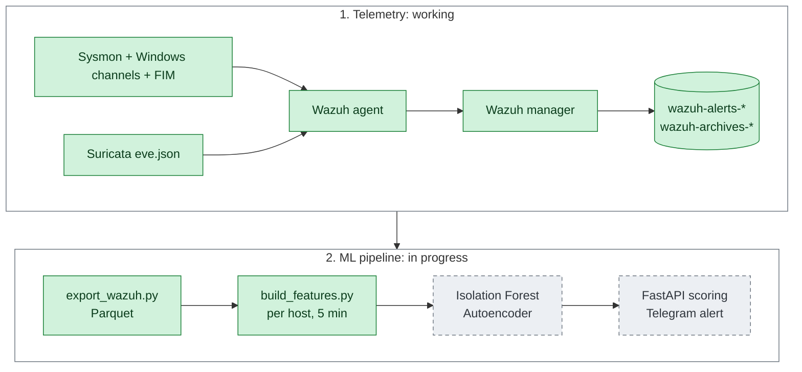
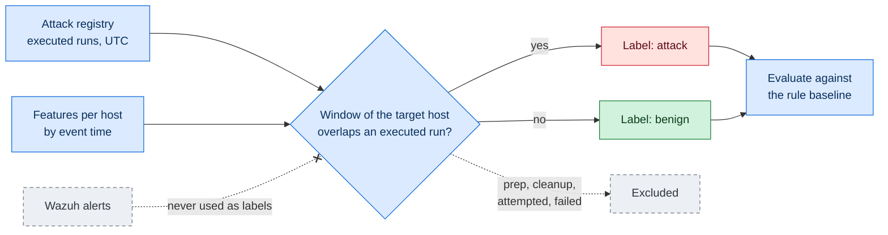

# 🛡️ Home SOC + Anomaly Detection with Machine Learning


A home SOC lab built with **Wazuh (HIDS/SIEM)**, **Suricata (NIDS)** and **Sysmon**, being extended with a
**machine learning anomaly detection layer** to reduce the false positives produced by static rules.

> **Status: in development.** Telemetry collection and benign traffic generation are working. The event
> export and feature extraction steps have run end to end on a real slice of lab data and are covered by
> reproducible tests. No attacks have been run in the lab yet and no model has been trained, so this
> project has **no detection metrics yet**.

---

## ⚙️ System Description

The lab runs on a Windows host with VMware Workstation, in a NAT network isolated from the home network.



| Component | Role | Status |
|---|---|---|
| **Ubuntu Server** | Wazuh manager, indexer and dashboard (all-in-one) | ✅ Working |
| **Windows (victim)** | Wazuh agent, Sysmon, Suricata (Npcap) and benign traffic generators | ✅ Working |
| **Atomic Red Team** | Adversary techniques executed on the Windows victim | 🕓 Planned |
| **Kali Linux** | Network attacks (Nmap, brute force) | 🕓 Planned |
| **ML layer** | Runs on the host, outside the VMs | 🚧 Export and features validated; models not written |

### Data flow



Green: working (export and features validated on a real slice of lab data). Grey: planned.

---

## 📁 Repository Structure

```
home-soc-ml/
├── data/
│   └── attack_windows_template.csv   # Attack registry template, schema v0.2 (labelling)
├── docs/
│   ├── images/architecture.svg       # Architecture diagram
│   └── SOC-ML-Lab-Guide.md           # Step-by-step guide to reproduce the lab
├── ml/                               # ML pipeline (export and features; models pending)
│   ├── export/export_wazuh.py        # Exports Wazuh events to Parquet
│   ├── features/build_features.py    # Builds features per host and 5-minute window
│   ├── features/FEATURES.md          # Versioned list of model features
│   ├── tests/test_pipeline.py        # Reproducible tests for the review fixes
│   ├── archive/                      # Versions exactly as reviewed (do not run)
│   ├── requirements.txt
│   └── README.md                     # Pipeline status, how to run it and review findings
├── scripts/windows/                  # Benign traffic generators
├── suricata/custom.rules             # Custom port scan rule
├── wazuh/
│   ├── agent-windows/ossec.conf      # Windows agent configuration
│   ├── manager/local_rules.xml       # Custom Wazuh rules
│   └── README.md                     # Lab configuration and known limitations
├── LICENSE
└── README.md
```

---

## 🔧 Requirements

| VM | OS | vCPU | RAM | Disk |
|---|---|---|---|---|
| Wazuh | Ubuntu Server 24.04 LTS | 4 | 8 GB | 50 GB |
| Victim | Windows 10/11 (evaluation) | 2 | 4 GB | 60 GB |
| Attacker | Kali Linux | 2 | 4 GB | 40 GB |

- **Virtualization:** VMware Workstation Pro, using the NAT network (VMnet8).
- **ML prototype:** Python with `requests`, `pandas`, `pyarrow` and `numpy`.

The full setup is in the [lab guide](docs/SOC-ML-Lab-Guide.md).

---

## 🧩 Main Components

### Detection rules

These rules are the baseline the ML layer will be compared against. They have not been evaluated against labelled attacks yet.

| Rule | Engine | Detects | MITRE ATT&CK |
|---|---|---|---|
| `sid 9000001` | Suricata | Possible port scan | T1046 |
| `100050` | Wazuh | Suspicious PowerShell commands in event 4104 | T1059.001 |

Rule `100050` also fires on benign traffic. This is intentional and documented in [`wazuh/README.md`](wazuh/README.md), because reducing these false positives is the goal of the ML layer.

### Benign traffic generators

| Script | Purpose |
|---|---|
| `generate_clean_normal_traffic.ps1` | Clean baseline activity, designed not to trigger alerts |
| `generate_varied_traffic.ps1` | Varied activity with a day/night rhythm |
| `simulate_normal_usage.ps1` | Noisy activity that triggers false positives by design |

### ML pipeline

| Stage | Status |
|---|---|
| Export events from the Wazuh indexer | ✅ Validated on a real slice of lab data |
| Features per host and 5-minute window | ✅ Validated on a real slice of lab data |
| Reproducible tests for the review fixes | ✅ Passing |
| Isolation Forest and autoencoder | 🕓 Not written yet |
| FastAPI scoring and Telegram notifications | 🕓 Not written yet |

See [`ml/README.md`](ml/README.md) for how to run the pipeline and the review findings.

---

## 🏷️ Labelling Methodology

Labels do **not** come from what Wazuh flags as an alert. They come from a manual registry of attack
executions (one row per run, with its Atomic test GUID, target host, UTC start and end, and status).
Only runs with status `executed` produce attack labels, and only for the target host. Preparation,
cleanup, attempted and failed periods are excluded from both classes. Everything else is treated as
benign activity.
Network events use the event time (`flow.start`), not the ingestion time, because flows are written
with a delay.



---

## 🗺️ Roadmap

- [x] Wazuh + Suricata + Sysmon telemetry working end to end
- [x] Benign traffic generators (clean, varied, noisy)
- [x] Custom scan rule (sid 9000001, T1046)
- [x] Lab configuration under version control (PowerShell 4104 rule, real-time FIM incl. Documents/Downloads)
- [x] Export and feature pipeline validated on real lab data, with reproducible tests
- [ ] Run attacks in the lab: Nmap, brute force and Atomic Red Team
- [ ] Dataset: benign activity + labelled attacks (MITRE ATT&CK)
- [ ] Models: Isolation Forest and autoencoder, evaluated against the rule-based baseline
- [ ] Scoring service (FastAPI) + Telegram notifications
- [ ] Docker Compose package + installation test on a clean VM
- [ ] OpenCanary honeypot on a Raspberry Pi

---

## ⚠️ Disclaimer

Educational project. Attacks are to be run only against machines owned by the author inside an isolated lab.
Do not use these techniques against any system without explicit authorization.

---

## 🧠 Credits

Developed by **Freddy Alejandro Zapata Armas** as a personal portfolio project.
Quito, Ecuador – 2026

## 📄 License

MIT
